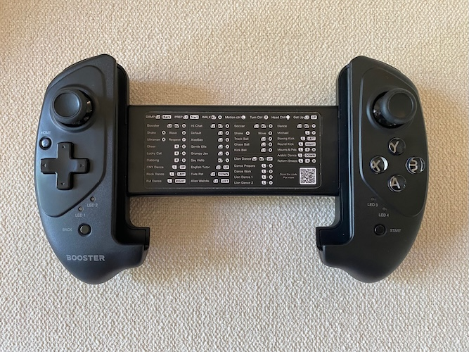

# Agents

The Application Programming Interface (API) defines commands that can be executed on the robot from a client device. Supported devices are the robot controller delivered with the Booster K1 or an Android tablet running the Booster Android application.
The devices communicate with the robot over a Bluetooth connection. The API is comprehensize and allows the user to set gait speed and direction and to execute stored moves. It provides accesss to high-speed edge processes, stereo depth visual data, microphone arrays, and real-time inference loop routines.
See [Developer Guide](https://docs.booster.tech/developer-guide). The robot version
must be at least v1.7.

This guide describes the custom agent, `Irish` which contains the following custom actions:
  * Countin - pause the robot and then issue a verbal cadence, "1,2,3 ..."
  * Jig - dance an Irish jig for 16 measures
  * Bow - execute a stage bow
  * Stand - bring the robot to attention
  * Wave - raise an arm in celebration
  * Chain - link the actions above into a single sequence


***************************************************************
## Table of Contents <a id="table-of-contents"></a>
 * [Controls](#controls)
 * [Countin](#countin)
 * [Jig](#jig)
 * [Bow, Stand, Wave](#bow)
 * [Chain](#chain)


*********************************************************
## Controls <a id="controls"></a>
#### Robot
The `F1` button on the robot's shoulder is re-programmed so that it's press triggers the Irish agent's fixed sequence of
actions: `Countin`,`Jig` and `Bow`. The robot mode must be `WALKING`, otherwise nothing will happen.

#### Joints
The 22 joints are listed below in the order returned by an *Easy Teach* session. The first 10 joints belong to the upper body and
can be moved without disturbing the balance mechanism. When setting upper joint
positions all positions must be set at once. Note: Joint names in simulation mode are slightly different that the  names in the
actual robot. Position units are radians. Torque is not returned when in simulation mode.

|   Joint | Min ~ rad | Max ~ rad | Min ~ deg | Max ~ deg | Max Velocity ~ rad/sec | Max Torque ~ ?? |
| :--------: | :----: | :----: | :----: | :----: | :----: | :----: |
| AAHead_Yaw | -1.03 | 1.03 | -59.0 | 59.0 | 20.0 | 6.0 |
| Head_Pitch | -0.30 | 0.75 | -17.2 | 43.0 | 20.0 | 6.0 |
| ALeft_Shoulder_Pitch | -2.95 | 1.20 | -169.0 | 68.8 | 20.0 | 14.0 |
| Left_Shoulder_Roll | -1.73 | 1.55 | -41.8 | 88.8 | 20.0 | 14.0 |
| Left_Elbow_Pitch | -1.90 | 1.90 | -108.9 | 108.9 | 20.0 | 14.0 |
| Left_Elbow_Yaw | -2.25 | 0.68 | -128.8 | 39.0 | 20.0 | 14.0 |
| ARight_Shoulder_Pitch | -2.95 | 1.20 | -169.0 | 68.8 | 20.0 | 14.0 |
| Right_Shoulder_Roll | -1.73 | 1.55 | -41.8 | 88.8 | 20.0 | 14.0 |
| Right_Elbow_Pitch | -1.90 | 1.90 | -108.9 | 108.9 | 20.0 | 14.0 |
| Right_Elbow_Yaw | -.68 | 2.25 | -39.0 | 128.8 | 20.0 | 14.0 |
| Left_Hip_Pitch | -2.98 | 2.20 | -170.7 | 126.0 | 25.0 | 68.0 |
| Left_Hip_Roll | -0.38 | 1.55 | 21.8 | 89.7 | 25.0 | 43.0 |
| Left_Hip_Yaw  | -1.03 | 1.03 | -59.0 | 59.0 | 25.0 | 38.3 |
| Left_Knee_Pitch | -0.02 | 2.22 | -1.1 | 127.2 | 25.0 | 112.0 |
| Left_Ankle_Pitch | -0.30 | 0.66 | -17.2 | 37.8 | 25.0 | 38.3 |
| Left_Ankle_Roll  | -0.28 | 0.72 | 16.0 | 41.3 | 25.0 | 38.3 |
| Right_Hip_Pitch | -2.98 | 2.20 | -170.7 | 126.0 | 25.0 | 68.0 |
| Right_Hip_Roll | -1.55 | 0.38 | -89.7 | 21.8 | 25.0 | 43.0 |
| Right_Hip_Yaw | -1.01 | 1.01 | -57.9 | 57.9 | 25.0 | 38.3 |
| Right_Knee_Pitch | -0.02 | 2.30 | -1.1 | 131.8 | 25.0 | 112.0 |
| Right_Ankle_Pitch | -0.30 | 0.66 | -17.2 | 37.8 | 25.0 | 38.3 |
| Right_Ankle_Roll | -0.28 | 0.72 | 16.0 | 41.3 | 25.0 | 38.3 |

#### Controller
The joystick control is powered (on or off) by pressing the "home" button. "Led 4" is illuminated when contact with the robot is live.


```                  Joystick Control  ```

With the robot in `WALKING` mode press `L2 + R2 + DOWN` to enter the `Irish` agent.

| Agent | <center>Actions</center> |<center>Buttons</center>
| :------: | :---------------------- | :----------: |
| Irish | Countin | A |
| | Jig | B |
| | Bow | X |
| | Chain | Y |

#### Android App
The Android application is customizable.

## Bow, Stand, Wave <a id="bow"></a>
#### Easy Teach

Each of the `Bow`, `Stand` and `Wave` actions were created using the `Easy Teach`
feature of the live robot. This is available on the *Android* app under the
`Irish` agent, `Custom` tab and the "+" option.

For each of the three actions the developer positions limbs into an appropriate
series of timed poses that are recorded for later playback.

Once recordings were complete, the resulting
*.json* file was found in a subdirectory of
```
/opt/booster/booster_agent_data/data agent_storage
        /chuckcoughlin.charlie/orchestrations
```
and copied back onto the development machine in the agent's `data` directory. The recording
and custom action were then deleted from the live robot.

After this, the `BoosterStudio` *AI Assistant* was asked to generate Python code to
use the file in an agent that executed the recorded action.
Starting with a stub version of the `Stand.py` class with an empty *execute* method, then ...

```
   "Modify Stand.py to use data/stand.json to drive
    the robot motion. stand.json is the result of an
    Easy Teach session on the robot"
```
The `joint_upper_control_example.py` sample provided hints for the remaining code.

#### Storage Manager
The agent `Storage Manager` only allows file operations relative to a root directory. For us this is
```
   /opt/booster/booster_agent_data/data/agent_storage/chuckcoughlin.charlie
```.
For `BoosterStudio`, populate the *.json* files that determine the trajectories of these actions. Before running the script
make sure that `DOCKER_ID` is defined. Use `docker ps` and choose the ID that is associated with the virtual robot.

```
  bin/setup_docker.sh
```
